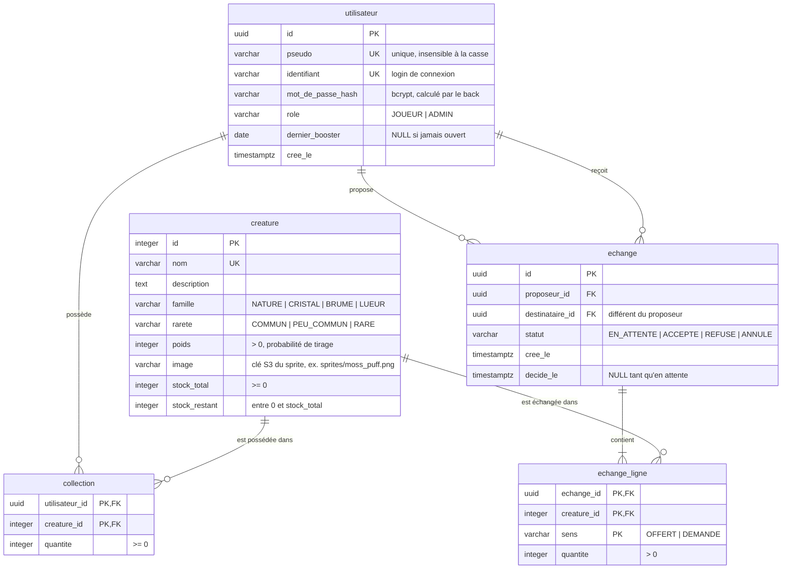

# CREATURA — Schéma de la base de données

PostgreSQL 16 · 5 tables · auteur : MDi · version 1 (10/11/2026)

## Diagramme

## Décisions et justifications

| Sujet | Choix | Justification |
|---|---|---|
| Stock limité | Global par créature (`stock_total`, `stock_restant`) | Rareté réelle : un nombre fini d'exemplaires existe dans le jeu. Les échanges déplacent les cartes sans toucher au stock. |
| Créature épuisée | Retirée du tirage ; si tout est épuisé, le booster est annulé (le joueur ne le perd pas) | Le joueur n'est jamais pénalisé par une rupture de stock. |
| Rareté, famille | Colonnes de `creature` avec `CHECK` | La rareté est une propriété de l'espèce, pas de la carte (validé par l'encadrant). Pas de table de référence : moins de jointures. |
| Probabilité | `poids` entier par créature | La somme n'a pas besoin de faire 100 % : ajouter une créature ou épuiser un stock ne casse pas les probabilités. |
| Booster quotidien | Colonne `utilisateur.dernier_booster` | Pas de table booster (simplification validée par l'encadrant). Un `UPDATE` conditionnel garantit 1 booster par jour, même avec des requêtes simultanées. |
| Jour du booster | Calculé à l'heure de Paris dans la requête | RDS est en UTC par défaut ; sinon le jour changerait à 1 h ou 2 h du matin. |
| Collection | Quantité par (joueur, créature), pas d'identifiant par carte | Les cartes sont identiques entre elles. Doublons = `quantite > 1`. |
| Échange n ↔ n | Tables `echange` + `echange_ligne` | Plusieurs cartes de chaque côté ne tiennent pas dans une seule ligne. |
| Cohérence des échanges | Une transaction côté back + `CHECK (quantite >= 0)` en filet de sécurité | Tout ou rien : ni perte ni duplication de cartes. La logique métier reste dans l'API. |
| Valeurs autorisées | `varchar` + `CHECK` (pas de type `ENUM`) | Plus simple à faire évoluer et mieux géré par les ORM. |
| Identifiants | UUID pour utilisateur et échange, entier pour créature | Les UUID exposés dans l'API ne sont pas devinables ; le catalogue reste lisible. |
| Source de vérité | Les fichiers SQL du dossier `db/` | Le back lit le schéma (ex. `prisma db pull` ou `synchronize: false`) au lieu de le générer : un seul schéma. |
| Langue | Français, snake_case, sans accents | Même vocabulaire que le cahier des charges et les cas d'usage. |
| Stats boosters (UC-12, UC-14) | Partielles pour l'instant | Conséquence de l'absence de table booster. Ajout possible plus tard sans rien casser. |

## Dictionnaire de données

### utilisateur
| Colonne | Type | Contraintes | Description |
|---|---|---|---|
| id | uuid | PK, défaut `gen_random_uuid()` | Identifiant |
| pseudo | varchar(30) | NOT NULL, unique sur `lower(pseudo)` | Nom affiché |
| identifiant | varchar(50) | NOT NULL, UNIQUE | Login de connexion |
| mot_de_passe_hash | varchar(255) | NOT NULL | Hash bcrypt (jamais le mot de passe en clair) |
| role | varchar(10) | NOT NULL, défaut `JOUEUR`, CHECK `JOUEUR`/`ADMIN` | Droits d'accès |
| dernier_booster | date | NULL | Dernier jour où un booster a été ouvert |
| cree_le | timestamptz | NOT NULL, défaut `now()` | Date d'inscription |

### creature
| Colonne | Type | Contraintes | Description |
|---|---|---|---|
| id | integer | PK, identity | Identifiant |
| nom | varchar(50) | NOT NULL, UNIQUE | Nom de l'espèce |
| description | text | | Texte affiché dans le catalogue |
| famille | varchar(20) | NOT NULL, CHECK `NATURE`/`CRISTAL`/`BRUME`/`LUEUR` | Famille (filtre UC-07) |
| rarete | varchar(20) | NOT NULL, CHECK `COMMUN`/`PEU_COMMUN`/`RARE` | Rareté de l'espèce |
| poids | integer | NOT NULL, CHECK `> 0` | Poids de tirage |
| image | varchar(255) | NOT NULL | Chemin relatif de l'image (le front ajoute l'URL du CDN) |
| stock_total | integer | NOT NULL, CHECK `>= 0` | Exemplaires existant au total |
| stock_restant | integer | NOT NULL, CHECK `0 <= stock_restant <= stock_total` | Exemplaires encore tirables |

### collection
| Colonne | Type | Contraintes | Description |
|---|---|---|---|
| utilisateur_id | uuid | PK, FK → utilisateur, ON DELETE RESTRICT | Propriétaire |
| creature_id | integer | PK, FK → creature, ON DELETE RESTRICT | Créature possédée |
| quantite | integer | NOT NULL, CHECK `>= 0` | Nombre d'exemplaires |

Index : `(creature_id) WHERE quantite > 0` — « qui possède cette carte ? » (UC-08).

### echange
| Colonne | Type | Contraintes | Description |
|---|---|---|---|
| id | uuid | PK, défaut `gen_random_uuid()` | Identifiant |
| proposeur_id | uuid | NOT NULL, FK → utilisateur | Joueur qui propose |
| destinataire_id | uuid | NOT NULL, FK → utilisateur, CHECK `<> proposeur_id` | Joueur qui décide |
| statut | varchar(12) | NOT NULL, défaut `EN_ATTENTE`, CHECK `EN_ATTENTE`/`ACCEPTE`/`REFUSE`/`ANNULE` | État |
| cree_le | timestamptz | NOT NULL, défaut `now()` | Date de proposition |
| decide_le | timestamptz | NULL ; CHECK : NULL si et seulement si `EN_ATTENTE` | Date de décision |

Index : `(destinataire_id, statut)`, `(proposeur_id)`.

### echange_ligne
| Colonne | Type | Contraintes | Description |
|---|---|---|---|
| echange_id | uuid | PK, FK → echange, ON DELETE CASCADE | Échange concerné |
| creature_id | integer | PK, FK → creature | Créature échangée |
| sens | varchar(8) | PK, CHECK `OFFERT`/`DEMANDE` | `OFFERT` = donnée par le proposeur, `DEMANDE` = donnée par le destinataire |
| quantite | integer | NOT NULL, CHECK `> 0` | Nombre d'exemplaires |

## Règles vérifiées par les tests

- Pour chaque créature : `stock_total = stock_restant + somme des quantités dans les collections`.
- Aucune quantité négative, aucun stock négatif.
- Un seul booster par joueur et par jour (heure de Paris).
- Un échange accepté modifie les deux collections, ou aucune.
