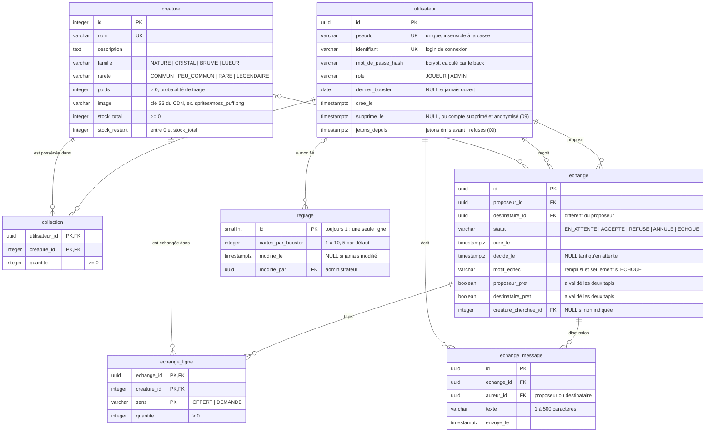

# CREATURA — Schéma de la base de données

PostgreSQL 16 · 5 tables · auteur : MDi · version 1 (10/11/2026)

## Diagramme

## Décisions et justifications

| Sujet | Choix | Justification |
|---|---|---|
| Stock limité | Global par créature (`stock_total`, `stock_restant`) | Rareté réelle : un nombre fini d'exemplaires existe dans le jeu. Les échanges déplacent les cartes sans toucher au stock. |
| Créature épuisée | Retirée du tirage ; si tout est épuisé, le booster est annulé (le joueur ne le perd pas) | Le joueur n'est jamais pénalisé par une rupture de stock. |
| Rareté, famille | Colonnes de `creature` avec `CHECK` | La rareté est une propriété de l'espèce, pas de la carte (validé par l'encadrant). Pas de table de référence : moins de jointures. |
| Probabilité | `poids` entier par créature | La somme n'a pas besoin de faire 100 % : ajouter une créature ou épuiser un stock ne casse pas les probabilités. |
| Booster quotidien | Colonne `utilisateur.dernier_booster` | Pas de table booster (simplification validée par l'encadrant). Un `UPDATE` conditionnel garantit 1 booster par jour, même avec des requêtes simultanées. |
| Jour du booster | Calculé à l'heure de Paris dans la requête | RDS est en UTC par défaut ; sinon le jour changerait à 1 h ou 2 h du matin. |
| Collection | Quantité par (joueur, créature), pas d'identifiant par carte | Les cartes sont identiques entre elles. Doublons = `quantite > 1`. |
| Échange n ↔ n | Tables `echange` + `echange_ligne` | Plusieurs cartes de chaque côté ne tiennent pas dans une seule ligne. |
| Cohérence des échanges | Une transaction côté back + `CHECK (quantite >= 0)` en filet de sécurité | Tout ou rien : ni perte ni duplication de cartes. La logique métier reste dans l'API. |
| Valeurs autorisées | `varchar` + `CHECK` (pas de type `ENUM`) | Plus simple à faire évoluer et mieux géré par les ORM. |
| Identifiants | UUID pour utilisateur et échange, entier pour créature | Les UUID exposés dans l'API ne sont pas devinables ; le catalogue reste lisible. |
| Source de vérité | Les fichiers SQL du dossier `db/` | Le back lit le schéma (ex. `prisma db pull` ou `synchronize: false`) au lieu de le générer : un seul schéma. |
| Langue | Français, snake_case, sans accents | Même vocabulaire que le cahier des charges et les cas d'usage. |
| Connexions (AS-71) | Table `connexion`, une ligne par login réussi, gardée 13 mois | Dernière connexion et connexions par jour ou par mois se calculent à la demande. Le renouvellement du jeton ne compte pas, sinon un joueur resté sur la page compterait une connexion toutes les 20 minutes. 13 mois : comparer un mois au même mois de l'année précédente. |
| Suppression d'un joueur (AS-71) | Demande faite par un admin, validée par un autre admin qu'il choisit (`demande_suppression`) | Aucun admin ne supprime seul des comptes. Les règles sont dans des fonctions SQL, testées dans `tests/test_schema.sql`. |
| Données d'un joueur supprimé (AS-71) | Tout ce qui n'appartient qu'à lui est effacé ; ses échanges terminés restent pour l'autre joueur, sans lien vers lui (`NULL`) | L'historique de l'autre joueur lui appartient aussi. Ses légendaires retournent dans le stock de l'édition limitée. |
| Réinitialisation du mot de passe (AS-75) | Lien généré par un admin, 5 minutes, usage unique, seule l'empreinte SHA-256 du jeton est stockée | Le joueur n'a pas d'adresse e-mail dans la base : l'admin lui transmet le lien. Lire la table ne permet pas de reconstituer un lien valable. |
| Comptes admin (AS-71) | Créés depuis le dashboard, mot de passe provisoire, désactivés (jamais supprimés) par un autre admin, toujours au moins deux actifs | Le premier admin reste créé au démarrage du back. Un admin désactivé garde son nom dans le journal des demandes. Avec moins de deux admins actifs, plus personne ne pourrait valider une suppression. |
| Stats boosters (UC-12, UC-14) | Partielles pour l'instant | Conséquence de l'absence de table booster. Ajout possible plus tard sans rien casser. |

## Dictionnaire de données

### utilisateur
| Colonne | Type | Contraintes | Description |
|---|---|---|---|
| id | uuid | PK, défaut `gen_random_uuid()` | Identifiant |
| pseudo | varchar(30) | NOT NULL, unique sur `lower(pseudo)` | Nom affiché |
| identifiant | varchar(50) | NOT NULL, UNIQUE | Login de connexion |
| mot_de_passe_hash | varchar(255) | NOT NULL | Hash bcrypt (jamais le mot de passe en clair) |
| role | varchar(10) | NOT NULL, défaut `JOUEUR`, CHECK `JOUEUR`/`ADMIN` | Droits d'accès |
| dernier_booster | date | NULL | Dernier jour où un booster a été ouvert |
| cree_le | timestamptz | NOT NULL, défaut `now()` | Date d'inscription |
| cree_par | uuid | NULL, FK → utilisateur, ON DELETE SET NULL | Admin qui a créé ce compte admin depuis le dashboard (AS-71) |
| mot_de_passe_provisoire | boolean | NOT NULL, défaut `false` | Admin qui doit encore remplacer le mot de passe choisi par son créateur (AS-71) |
| desactive_le | timestamptz | NULL | Admin désactivé par un autre admin : plus de connexion (AS-71) |
| desactive_par | uuid | NULL, FK → utilisateur ; CHECK : jamais soi-même | Admin auteur de la désactivation (AS-71) |

`ck_utilisateur_compte_admin` : `cree_par`, `mot_de_passe_provisoire` et la désactivation ne concernent que les comptes `ADMIN`.

### creature
| Colonne | Type | Contraintes | Description |
|---|---|---|---|
| id | integer | PK, identity | Identifiant |
| nom | varchar(50) | NOT NULL, UNIQUE | Nom de l'espèce |
| description | text | | Texte affiché dans le catalogue |
| famille | varchar(20) | NOT NULL, CHECK `NATURE`/`CRISTAL`/`BRUME`/`LUEUR` | Famille (filtre UC-07) |
| rarete | varchar(20) | NOT NULL, CHECK `COMMUN`/`PEU_COMMUN`/`RARE`/`LEGENDAIRE` | Rareté de l'espèce (`LEGENDAIRE` : 06_evolution_rarete_legendaire.sql) |
| poids | integer | NOT NULL, CHECK `> 0` | Poids de tirage |
| image | varchar(255) | NOT NULL | Clé du fichier dans le bucket S3 (ex. `sprites/moss_puff.png`) ; le back y ajoute l'URL du CDN CloudFront |
| stock_total | integer | NOT NULL, CHECK `>= 0` | Exemplaires existant au total |
| stock_restant | integer | NOT NULL, CHECK `0 <= stock_restant <= stock_total` | Exemplaires encore tirables |

### collection
| Colonne | Type | Contraintes | Description |
|---|---|---|---|
| utilisateur_id | uuid | PK, FK → utilisateur, ON DELETE RESTRICT | Propriétaire |
| creature_id | integer | PK, FK → creature, ON DELETE RESTRICT | Créature possédée |
| quantite | integer | NOT NULL, CHECK `>= 0` | Nombre d'exemplaires |

Index : `(creature_id) WHERE quantite > 0` — « qui possède cette carte ? » (UC-08).

### echange
| Colonne | Type | Contraintes | Description |
|---|---|---|---|
| id | uuid | PK, défaut `gen_random_uuid()` | Identifiant |
| proposeur_id | uuid | NOT NULL, FK → utilisateur | Joueur qui propose |
| destinataire_id | uuid | NOT NULL, FK → utilisateur, CHECK `<> proposeur_id` | Joueur qui décide |
| statut | varchar(12) | NOT NULL, défaut `EN_ATTENTE`, CHECK `EN_ATTENTE`/`ACCEPTE`/`REFUSE`/`ANNULE`/`ECHOUE` | État ; `ECHOUE` = acceptation impossible, une carte n'était plus disponible |
| cree_le | timestamptz | NOT NULL, défaut `now()` | Date de proposition |
| decide_le | timestamptz | NULL ; CHECK : NULL si et seulement si `EN_ATTENTE` | Date de décision (ou d'échec) |
| motif_echec | varchar(30) | NULL ; CHECK : rempli si et seulement si `ECHOUE` | Code de l'échec (ex. `CARDS_UNAVAILABLE`) |

| proposeur_pret | boolean | NOT NULL, défaut `false` | Le proposeur a validé les deux tapis tels qu'ils sont |
| destinataire_pret | boolean | NOT NULL, défaut `false` | Le destinataire a validé les deux tapis tels qu'ils sont |
| creature_cherchee_id | integer | NULL, FK → creature, ON DELETE SET NULL | Carte que le proposeur cherche chez le destinataire |

Index : `(destinataire_id, statut)`, `(proposeur_id)`, `(proposeur_id, destinataire_id) WHERE statut = 'EN_ATTENTE'`.

Les trois dernières colonnes viennent de `init/05_evolution_salle_echange.sql` : un échange est une
**salle** où chaque joueur pose ses cartes sur son tapis (`echange_ligne`), discute (`echange_message`)
et valide. L'échange est conclu quand les deux joueurs ont validé ; toute modification d'un tapis
retire les deux validations (règle appliquée par l'API).

### echange_ligne
| Colonne | Type | Contraintes | Description |
|---|---|---|---|
| echange_id | uuid | PK, FK → echange, ON DELETE CASCADE | Échange concerné |
| creature_id | integer | PK, FK → creature | Créature échangée |
| sens | varchar(8) | PK, CHECK `OFFERT`/`DEMANDE` | `OFFERT` = donnée par le proposeur, `DEMANDE` = donnée par le destinataire |
| quantite | integer | NOT NULL, CHECK `> 0` | Nombre d'exemplaires |

Un tapis peut être vide tant que l'échange est en cours : la salle s'ouvre tapis vides.

### echange_message
Ajoutée par `init/05_evolution_salle_echange.sql`.

| Colonne | Type | Contraintes | Description |
|---|---|---|---|
| id | uuid | PK, défaut `gen_random_uuid()` | Identifiant |
| echange_id | uuid | NOT NULL, FK → echange, ON DELETE CASCADE | Échange concerné |
| auteur_id | uuid | NOT NULL, FK → utilisateur | Proposeur ou destinataire (vérifié par l'API) |
| texte | varchar(500) | NOT NULL, CHECK non vide | Message |
| envoye_le | timestamptz | NOT NULL, défaut `now()` | Date d'envoi |

Index : `(echange_id, envoye_le)` — la discussion d'un échange, dans l'ordre.

### reglage
Ajoutée par `init/04_evolution_reglage_echec.sql` (avec `echange.motif_echec` et le statut `ECHOUE`).

| Colonne | Type | Contraintes | Description |
|---|---|---|---|
| id | smallint | PK, défaut 1, CHECK `= 1` | Une seule ligne : réglages globaux |
| cartes_par_booster | integer | NOT NULL, défaut 5, CHECK entre 1 et 10 | Cartes tirées par booster (modifiable depuis le dashboard admin) |
| modifie_le | timestamptz | NULL ; CHECK : renseigné dès qu'il y a un auteur | Dernière modification |
| modifie_par | uuid | NULL, FK → utilisateur, ON DELETE SET NULL | Administrateur auteur |

### Joueurs et administrateurs (AS-71)
Ajouté par `init/10_evolution_joueurs_admin.sql`.

#### connexion
| Colonne | Type | Contraintes | Description |
|---|---|---|---|
| id | bigint | PK, identity | Identifiant |
| utilisateur_id | uuid | NOT NULL, FK → utilisateur, ON DELETE CASCADE | Compte connecté |
| le | timestamptz | NOT NULL, défaut `now()` | Date et heure de la connexion |

Index : `(utilisateur_id, le)` pour la dernière connexion et les comptages ; `(le)` pour la purge.

#### demande_suppression
| Colonne | Type | Contraintes | Description |
|---|---|---|---|
| id | uuid | PK | Identifiant |
| demande_par | uuid | NOT NULL, FK → utilisateur | Admin qui fait la demande |
| valideur_id | uuid | NOT NULL, FK → utilisateur, CHECK `<> demande_par` | Seul admin qui peut valider ou refuser |
| motif | varchar(500) | NULL | Raison donnée par le demandeur |
| statut | varchar(10) | NOT NULL, CHECK `EN_ATTENTE`/`VALIDEE`/`REFUSEE`/`ANNULEE`/`EXPIREE` | État |
| nombre_comptes | integer | NOT NULL, CHECK `> 0` | Joueurs concernés, gardé dans le journal |
| cree_le | timestamptz | NOT NULL, défaut `now()` | Date de la demande |
| traite_le | timestamptz | rempli dès que le statut n'est plus `EN_ATTENTE` | Date de la décision |

#### demande_suppression_joueur
Joueurs d'une demande : `(demande_id, utilisateur_id)`, les deux en `ON DELETE CASCADE`. Après validation, les lignes partent avec les joueurs : le journal ne garde que leur nombre.

#### echange (modifié)
`proposeur_id` et `destinataire_id` deviennent `NULL` quand le joueur est supprimé (`ON DELETE SET NULL`). `ck_echange_joueurs` : un échange en attente a ses deux joueurs, un échange terminé au moins un. Les messages d'un joueur supprimé partent avec lui (`fk_echange_message_auteur` en `ON DELETE CASCADE`).

#### Fonctions
| Fonction | Rôle |
|---|---|
| `creatura_enregistrer_connexion(compte)` | Ajoute une connexion, efface celles de plus de 13 mois |
| `creatura_demander_suppression(demandeur, valideur, joueurs[], motif)` | Crée une demande. Refuse : demandeur ou validateur non admin actif, validateur = demandeur, liste vide, compte non joueur, joueur déjà dans une demande en attente |
| `creatura_traiter_demande(demande, admin, valider)` | Validation (suppression immédiate) ou refus, par le validateur choisi seulement |
| `creatura_annuler_demande(demande, admin)` | Annulation par le demandeur, tant que la demande est en attente |
| `creatura_expirer_demandes()` | Passe en `EXPIREE` les demandes en attente depuis plus de 7 jours ; appelée par les fonctions ci-dessus |
| `creatura_supprimer_joueur(compte)` | Efface un joueur : légendaires remises en stock, collection, échanges en attente, connexions, boosters, messages, compte. Ses échanges terminés restent pour l'autre joueur |
| `creatura_desactiver_admin(cible, admin)` | Désactive un admin (jamais soi-même, jamais s'il resterait moins de deux admins actifs) et annule ses demandes en attente |

Chaque refus porte un nom (`ck_demande_suppression_…`, `ck_desactivation_…`), traduit en message par le back comme une contrainte de table.

### reinitialisation_mdp (AS-75)
Ajoutée par `init/12_evolution_reinitialisation_mdp.sql`. Un admin génère, depuis la fiche d'un joueur, un lien qu'il lui envoie.

| Colonne | Type | Contraintes | Description |
|---|---|---|---|
| id | bigint | PK, identity | Identifiant |
| utilisateur_id | uuid | NOT NULL, FK → utilisateur, ON DELETE CASCADE | Joueur concerné |
| jeton_hash | char(64) | NOT NULL, UNIQUE, CHECK hexadécimal | Empreinte SHA-256 du jeton du lien ; le jeton lui-même n'est jamais stocké |
| cree_par | uuid | NULL, FK → utilisateur, ON DELETE SET NULL | Admin qui a généré le lien |
| cree_le | timestamptz | NOT NULL | Création |
| expire_le | timestamptz | NOT NULL, défaut `now() + 5 minutes`, CHECK `> cree_le` | Fin de validité |
| utilise_le | timestamptz | NULL | Le joueur a choisi son nouveau mot de passe |
| annule_le | timestamptz | NULL ; CHECK : jamais avec `utilise_le` | Remplacé par un lien plus récent |

Index unique partiel `(utilisateur_id) WHERE utilise_le IS NULL AND annule_le IS NULL` : un seul lien en cours par joueur.

## Règles vérifiées par les tests

- Pour chaque créature : `stock_total = stock_restant + somme des quantités dans les collections`.
- Aucune quantité négative, aucun stock négatif.
- Un seul booster par joueur et par jour (heure de Paris).
- Un échange accepté modifie les deux collections, ou aucune.
